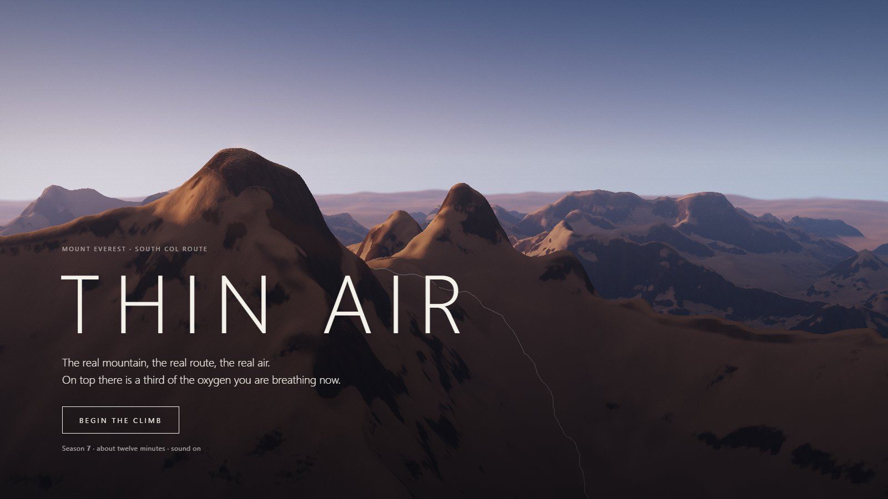
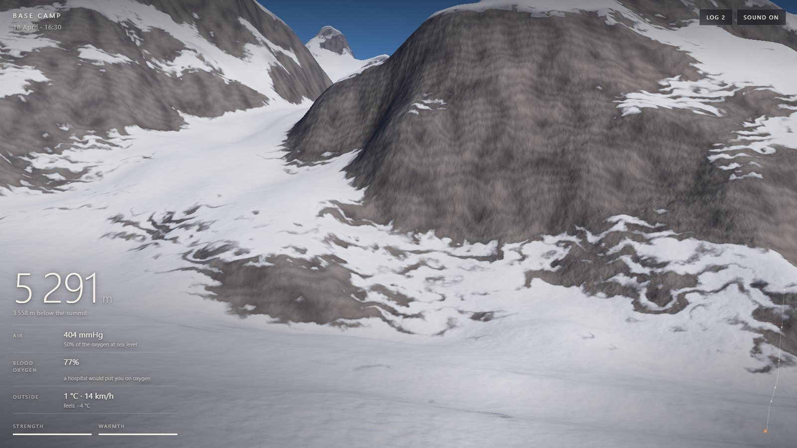
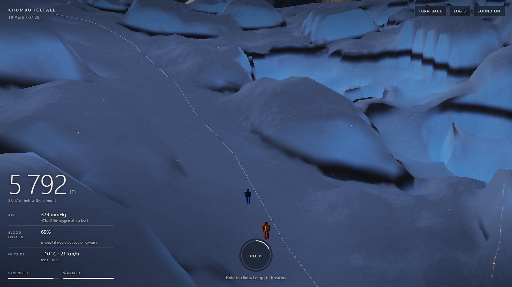
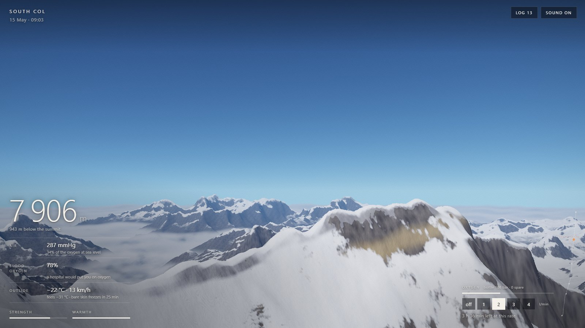
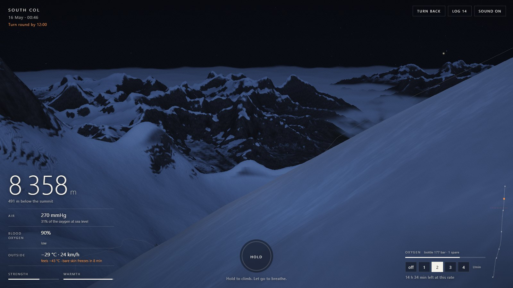

<a href="https://pratyushshivam.github.io/thin-air/"></a>

<p align="center">
  <a href="https://pratyushshivam.github.io/thin-air/"></a>
  <a href="https://github.com/pratyushshivam/thin-air/actions/workflows/ci.yml"></a>
  <a href="LICENSE"></a>
  
</p>

<p align="center">
  <a href="https://pratyushshivam.github.io/thin-air/"><b>Climb it</b></a> ·
  <a href="#how-to-climb">How to climb</a> ·
  <a href="#the-numbers">The numbers</a> ·
  <a href="#what-is-real-and-what-is-not">What is real and what is not</a> ·
  <a href="#checked-against-measurements">Checked against measurements</a> ·
  <a href="#run-it">Run it</a> ·
  <a href="https://www.pratyushshivam.com/">pratyushshivam.com</a>
</p>

# Thin Air

**Climb Mount Everest from Base Camp to the summit, on the real mountain, by the real route, breathing the real air.**

The mountain is built from satellite elevation data. The line you climb is the South Col route as it is mapped. The sun is where the sun is on that date at that hour, and the stars over the South Col at midnight are the ones that are there. The barometer, your blood oxygen, the wind chill and the gauge on your oxygen bottle are all worked out from published formulas and pinned to measurements taken on Everest.

You can reach the top. You can turn round a hundred metres short of it and walk away, and the page treats that as the real ending it is. You can also not come down.

**Climb:** [pratyushshivam.github.io/thin-air](https://pratyushshivam.github.io/thin-air/)

<table>
<tr>
<td width="50%" valign="top"><br><sub><b>Base Camp.</b> The line ahead is the mapped route into the Khumbu Icefall. The air here already holds half the oxygen it does at the sea.</sub></td>
<td width="50%" valign="top"><br><sub><b>The Khumbu Icefall</b>, before the sun is on it. You hear it creak.</sub></td>
</tr>
<tr>
<td width="50%" valign="top"><br><sub><b>The South Col,</b> 7,906 m. The peaks on the horizon are the real ones, where they really are.</sub></td>
<td width="50%" valign="top"><br><sub><b>Summit night.</b> −29 °C, 25 km/h of wind, and a turnaround time you set yourself.</sub></td>
</tr>
</table>

There is no account, no server and no tracking, and nothing to upload. The code is about 210 kB compressed and the mountain is 1 MB.

## How to climb

There is one control. **Hold** the ring (or the space bar) to climb. **Let go** to breathe. The ring fills as you run out of breath; fill it and you stop anyway, bent over your axe. Low down you can walk for a long time between rests. Near the top you get a few steps.

- **Drag** to look around, **scroll or pinch** to move the camera in and out.
- When the wind rises, **stand still**. Walking into a gust on the ridge costs you.
- From Camp III you carry **oxygen**. The buttons set the regulator from off to 4 litres a minute. More helps more and runs out sooner.
- **Turn back** is always there. Above Camp II it ends the expedition, alive.

Between climbs you decide: when to leave for the icefall, whether to go up a second time to acclimatise, which day's forecast to trust, when to leave the South Col, and at what hour you will turn round whether you have summited or not. The game will ask you about that last one again, at that hour, when you are 100 metres from the top and not thinking clearly.

One climb takes about twelve minutes and compresses six weeks. Every season is grown from a number (`?seed=1953` in the address), so the same season always has the same weather and you can try it again knowing what is coming.

## The numbers

| | |
|---|---|
| Summit | 8,848.86 m, the height Nepal and China announced together on 8 December 2020 |
| Air pressure on top | about 253 mmHg, against 760 at the sea |
| Oxygen in a breath on top | 29% of a breath at sea level |
| Blood oxygen measured at 8,400 m | 24.6 mmHg (a healthy person at sea level: about 95) |
| Work a climber can do on top | under a quarter of sea level |
| The death zone | above about 8,000 m |
| One oxygen bottle | about 1,040 litres: 8.7 hours at 2 l/min, 4.3 hours at 4 |
| The summit in May | −26 °C, 58 km/h of wind, wind chill −45 °C, exposed skin freezes in about 6 minutes |
| The summit in January | −36 °C, 151 km/h |
| First ascent | Tenzing Norgay and Edmund Hillary, 11:30 on 29 May 1953 |
| First without bottled oxygen | Reinhold Messner and Peter Habeler, 8 May 1978 |
| Who dies up high, and when | of deaths above 8,000 m from 1921 to 2006, 56% were on the way down from the summit |

## What is real and what is not

**Real**

- **The shape of the mountain.** [Copernicus DEM GLO-30](https://dataspace.copernicus.eu/explore-data/data-collections/copernicus-contributing-missions/collections-description/COP-DEM), a 30 metre elevation model made from the TanDEM-X radar satellites. The page ships a 1,024 × 1,024 grid at one arc-second around the route (about 28 by 32 km) and a coarser 512 × 512 grid for the horizon, so Makalu, Cho Oyu, Pumori and Ama Dablam stand where they stand.
- **The route.** The "Everest South Col" route relation and the camp positions from [OpenStreetMap](https://www.openstreetmap.org/relation/17822898): 611 mapped points, 12.4 km from Base Camp to the summit.
- **The sun and the stars.** The sun's position comes from NOAA's solar position equations for the date and the Nepal clock time. Shadows are cast by the real relief. The night sky is every star to magnitude 5.6 from the [HYG catalogue](https://github.com/astronexus/HYG-Database), turned to Everest's latitude and the hour.
- **Air pressure.** John West's model atmosphere for the Himalaya, which gives the 253 mmHg that was measured on the summit in 1981 where the textbook atmosphere gives 236.
- **Blood oxygen.** The alveolar gas equation and the Severinghaus haemoglobin curve, with the Bohr shift, fitted to arterial blood drawn from four climbers at 8,400 m in 2007.
- **Bottled oxygen.** The regulator's flow is expanded to the thin air by the gas laws and mixed into each breath, which is why two litres a minute lowers the mountain by about two kilometres and does not take you to sea level.
- **Wind chill and frostbite times.** The 2001 index used by the US and Canadian weather services, and Environment Canada's frostbite bands.
- **The history in the log.** Dates, names and counts are from the sources below. Where sources disagree (deaths at Base Camp in 2015: 17, 18 or 19) the log says so.

**Corrected**

- **The top of the mountain.** Thirty-metre data rounds off knife-edges. Copernicus reads 8,724 m at the surveyed position of the summit and is 50 to 170 m low along the whole Southeast Ridge; JAXA's ALOS model reads 8,768 m. I raised the ridge the route climbs to four surveyed heights (South Col 7,906, Balcony 8,430, South Summit 8,749, summit 8,848.86 m) and nine named summits on Lhotse and Nuptse to their mapped heights, each tapering to nothing within 400 m. Everything else is the data as published. The rule is in [`scripts/build-terrain.mjs`](scripts/build-terrain.mjs).
- **Base Camp's height.** Usually given as 5,364 m. The elevation model reads 5,291 m where the mapped route starts; the camp stretches along the glacier and the ice has thinned. The altimeter shows the model.

**Not real**

- **The ground within about 190 m of you.** One sample every 30 m is the mountain but not the icefall's towers. Close to the climber the page adds invented relief of the right kind (ice blocks and crevasses in the icefall, wind-packed snow in the Cwm, steps on the ridge) and fades it out so it sits on the real surface. The Hillary Step, the ladders and the fixed ropes are not modelled.
- **Snow and rock.** Where rock shows is decided from steepness and height with noise, not from imagery. The Yellow Band is painted where the route crosses it and on the summit pyramid.
- **The weather.** Each season is generated. Its shape is the real one (jet stream on the summit through April, short calm windows in the second half of May, the route closing in early June) and its numbers sit inside the measured climate, but it is not any real year.
- **How fast you tire, cool and recover.** The oxygen and pressure are physics. Strength, warmth, the speed of climbing and how long a brain lasts on too little oxygen are simple models tuned so that leg times come out in the range real climbers report (Base Camp to Camp I in about four hours, the South Col to the summit in about nine). They are not medicine.
- **Acclimatisation** is one number that nights at altitude push up. Pulmonary oedema strikes on a seeded chance if you go high after a single rotation.
- **Work capacity between sea level and the summit** is a smooth curve through one measured point at the top.
- **Clouds, the snow plume, spindrift, sound.** All made in the browser. The sound is synthesised from noise and sine waves; there are no recordings.
- **The moon.** There is none; summit night is by starlight.
- **Time.** About three and a half minutes pass for every second you climb.
- **Other people.** You climb with one partner. The headlamps of other teams on summit night and the queue below the summit on a crowded day are there; nobody else is simulated.

## Checked against measurements

`npm test` runs 40 checks. Among them:

| Check | Source value | Model |
|---|---|---|
| Pressure at 5,400 / 6,300 / 8,050 m and the summit | 400.4 / 351.0 / 283.6 / 253 mmHg (West et al. 1983) | within 2%, summit within 1 mmHg |
| Pressure at 8,400 m | 272 mmHg (Grocott et al. 2009) | within 2% |
| Inspired oxygen pressure on the summit | 43 mmHg | 43.1 |
| Haemoglobin half saturated | 26.86 mmHg (Severinghaus 1979) | 26.86 |
| Arterial oxygen and CO2 at 8,400 m | 24.6 and 13.3 mmHg (Grocott et al. 2009) | within 2.5 and 0.5 mmHg |
| Wind chill, four rows of Environment Canada's table | −15, −30, −48, −64 °C | the same, rounded |
| Summit in May, −26 °C and 58 km/h | −45 °C (Szymczak et al. 2021) | within 1.5 °C |
| Sun over Everest on 23 May | overhead near noon, rising east-north-east a little after five | the same |
| Oxygen bottle, 4 l at 260 bar | 1,040 l | 8.7 h at 2 l/min, 4.3 h at 4 |

The rest play whole expeditions with a rule-following climber: a patient one summits and comes home, the same one without oxygen does not reach the top, one who goes up after a single rotation is flown out, one who ignores the forecast and the turnaround time dies, and the same seed always gives the same climb.

## Sources

- **Height.** Survey Department of Nepal and China, announced 8 December 2020: 8,848.86 m.
- **Pressure.** West, J. B. et al. (1983) "Barometric pressures at extreme altitudes on Mt. Everest", *J. Appl. Physiol.* 54(5):1188–94. West, J. B. (1996) "Prediction of barometric pressures at high altitudes with the use of model atmospheres", *J. Appl. Physiol.* 81(4):1850–54. Matthews, T. et al. (2020) *iScience* 23:101718.
- **Blood.** Grocott, M. P. W. et al. (2009) "Arterial blood gases and oxygen content in climbers on Mount Everest", *N. Engl. J. Med.* 360:140–9. Severinghaus, J. W. (1979) "Simple, accurate equations for human blood O2 dissociation computations", *J. Appl. Physiol.* 46(3):599–602. West, J. B. et al. (1983) "Maximal exercise at extreme altitudes on Mount Everest", *J. Appl. Physiol.* 55(3):688–98.
- **Weather.** Matthews, T. et al. (2020) "Going to extremes: installing the world's highest weather stations on Mount Everest", *Bull. Am. Meteorol. Soc.* 101:E1870–90. Matthews, T. et al. (2022) *BAMS* 103:E2827–35. Szymczak, R. K. et al. (2021) *Int. J. Environ. Res. Public Health* 18:3040. Moore, G. W. K. and Semple, J. L. (2011) *High Alt. Med. Biol.* 12:271–5. Pugh, L. G. C. E. (1954) *J. Glaciol.*
- **Wind chill.** US National Weather Service wind chill chart (2001 index); Environment and Climate Change Canada, wind chill index and frostbite times.
- **Deaths.** Firth, P. G. et al. (2008) "Mortality on Mount Everest, 1921–2006", *BMJ* 337:a2654. The Himalayan Database, totals to December 2025.
- **Route, times and oxygen practice.** Alan Arnette's South Col route notes; Alpine Ascents' Everest itinerary; Wikipedia on bottled oxygen in climbing (Poisk cylinder figures), the Khumbu Icefall, the Hillary Step, and the 1996, 2014 and 2015 disasters.
- **Sun.** NOAA Global Monitoring Laboratory, solar position equations.

## Run it

```bash
npm install
npm run dev
```

```bash
npm test
```

```bash
npm run build
```

The built page in `dist/` is static and works from any folder on any host.

### Rebuild the mountain

The baked terrain is in the repository, so you do not need this to run the page. To make it again, download the four Copernicus GLO-30 tiles `N27_00_E086`, `N27_00_E087`, `N28_00_E086` and `N28_00_E087` from the [open bucket](https://registry.opendata.aws/copernicus-dem/) into `raw/dem/`, put the OpenStreetMap route relation in `raw/route-osm.json`, and run `npm run build:terrain`. `scripts/build-stars.mjs` does the same for the sky from the HYG catalogue.

## Credits and licences

The code is MIT licensed.

- Terrain: produced using Copernicus WorldDEM-30 © DLR e.V. 2010-2014 and © Airbus Defence and Space GmbH 2014-2018 provided under COPERNICUS by the European Union and ESA; all rights reserved. The organisations in charge of the Copernicus programme by law or by delegation do not incur any liability for any use of the Copernicus WorldDEM-30.
- Route and place positions: © OpenStreetMap contributors, [ODbL](https://www.openstreetmap.org/copyright).
- Stars: HYG database 4.1 by David Nash, CC BY-SA 4.0.
- Typeface: Geist by Vercel, SIL Open Font License 1.1.
- Drawn with [three.js](https://threejs.org/).

This is a game about a place where people have died, many of them Sherpas working for other people's summits. It names no one as scenery.

Made by [Pratyush Shivam](https://www.pratyushshivam.com/).
